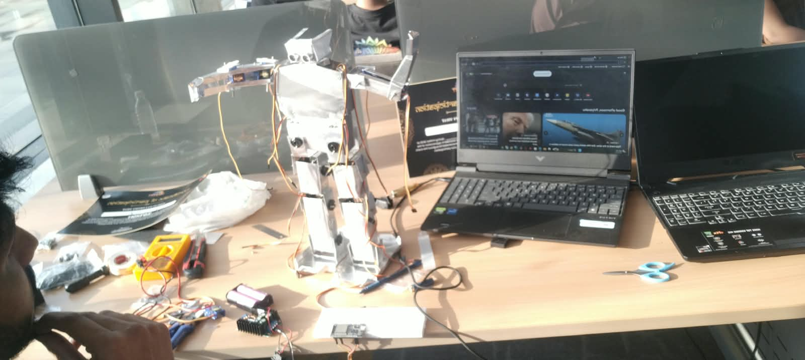

# Humanoid Robot (ESP32, 15 Servos)

A 15-servo humanoid robot prototype built in 10 days for **IoTHON at Unifest 2K26** (Galgotias Educational Institutions).

## Overview
I designed and built the mechanical structure, wiring, and servo calibration myself. A teammate joined on the event day (7 April) to help with the control software, which was still in progress at the demo.

## Timeline
- **28 March 2026:** Started the build
- **6 April 2026:** Finished the hardware
- **7 April 2026:** Demonstrated at IoTHON, Unifest 2K26
- **After the event:** Servo testing and arm movement development (see the demo video)

## Hardware
| Part | Quantity | Use |
|------|----------|-----|
| ESP32 DevKit | 1 | Main controller |
| PCA9685 16-channel PWM driver | 1 | Drives all 15 servos over I2C |
| MG955 servo | 8 | Lower body (legs) |
| SG90 servo | 7 | Upper body (arms, head) |
| External battery | 1 | Servo power |
| 10 A buck converter | 1 | Steps the battery voltage down for the servos |
| Metal sheets | – | Hand-cut body frame |

The PCA9685 has 16 channels, so 15 servos use 15 of them with one spare.

## How I built it
1. **Body fabrication:** Hand-cut and shaped metal sheets to size, then made mounting holes and openings to hold the servos.
2. **Servo mounting:** Fitted 8 MG955 servos in the lower body and 7 SG90 servos in the upper body.
3. **Wiring:** Connected the servos to the PCA9685, the PCA9685 to the ESP32, and the servo supply to the battery through the buck converter.
4. **Calibration:** Set each servo's position to get balanced, coordinated movement.
5. **Movements:** Basic motions such as hand waving, raising arms, and a dance routine.
6. **Event day:** Demonstrated at IoTHON. A teammate helped with the control software.

## Challenges and what I learned
- Managing the mechanical, electrical, and software work alone was the hardest part.
- Next time I would start the software earlier and test each joint as I build it.

## Status
Hardware and calibration are complete. The control software was unfinished at the event, and I'm continuing it with servo tests and arm movement development.

**Planned:** Bluetooth control from a phone app, with buttons for movements such as both hands up and waving.

## Media
- Demo video (servo test and arm movement): [humanoid_robot_linkedin_video.mp4](humanoid_robot_linkedin_video.mp4)
- Event: Certificate of Participation, IoTHON, Unifest 2K26

## Author
Priyanshu Singh | ECE student | [LinkedIn](https://www.linkedin.com/in/priyanshu-singh-9a3256384)
